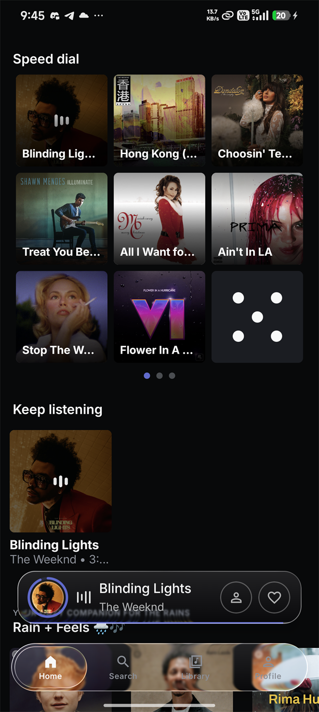
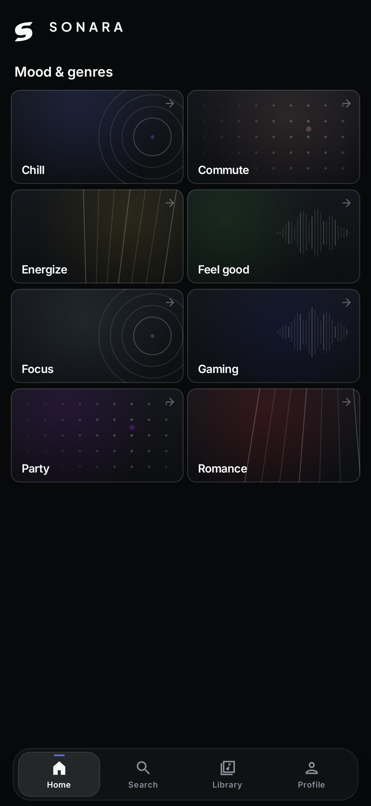
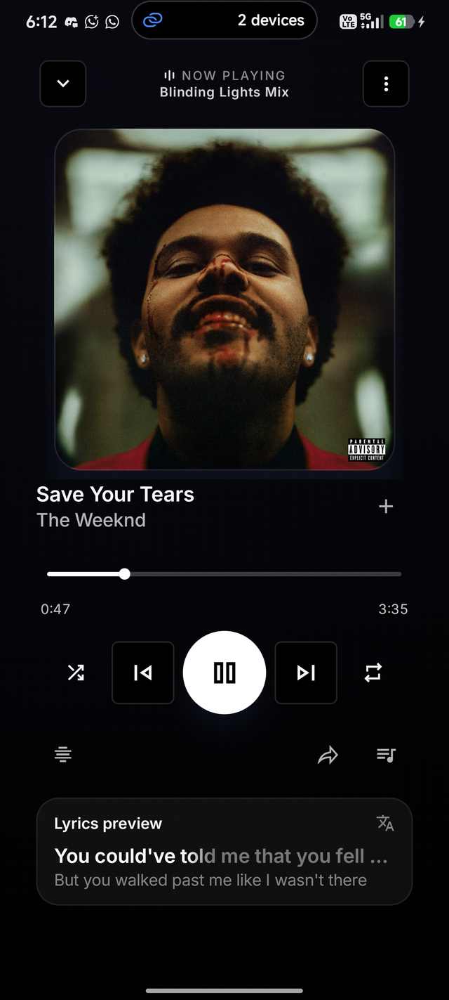
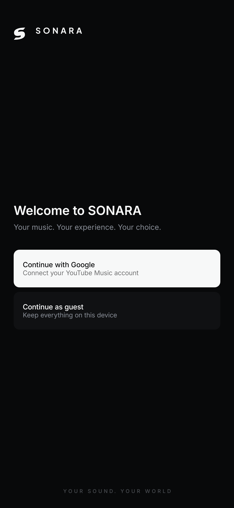
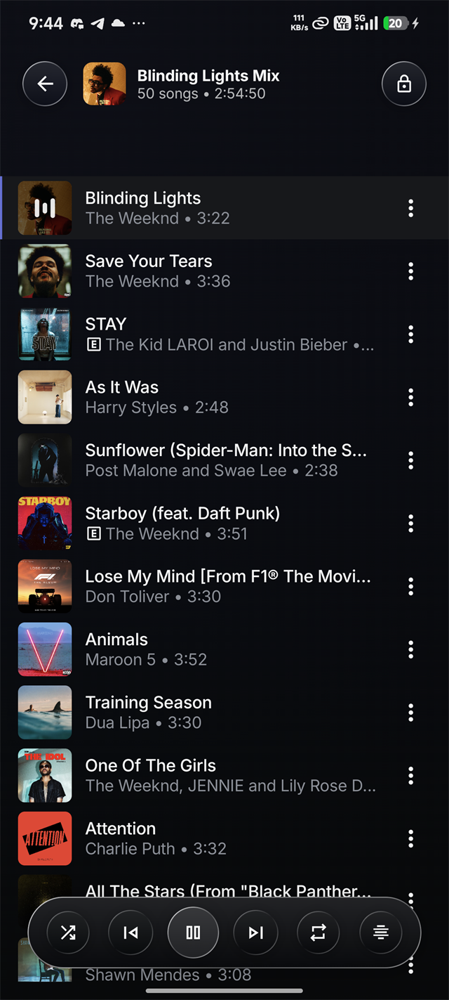
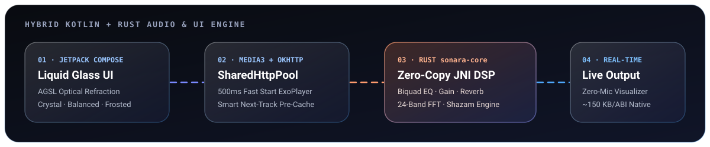

<div align="center">



<br/>

<p align="center">
  <a href="README.md"></a>
  <a href="README.en.md"></a>
</p>

<p align="center">
  <a href="https://github.com/Arkrega/Sonara/releases/latest"></a>
  <a href="https://github.com/Arkrega/Sonara/releases"></a>
  
  
  
  <a href="LICENSE"></a>
</p>

<p align="center">
  <a href="https://github.com/Arkrega/Sonara/releases/latest"><strong>⬇️ Download Latest APK</strong></a>
  &nbsp;·&nbsp;
  <a href="https://sonara.my.id/"><strong>🌐 Website</strong></a>
  &nbsp;·&nbsp;
  <a href="changelog.md"><strong>📋 Changelog</strong></a>
  &nbsp;·&nbsp;
  <a href="README.md"><strong>🇮🇩 Baca dalam Bahasa Indonesia</strong></a>
</p>

</div>

> [!WARNING]
> If YouTube Music is unavailable in your region, Sonara requires a VPN or proxy connecting to a supported region for online services to work

<div align="center">

</div>

<h2 align="center">📱 Screenshots</h2>

<p align="center"><sub>Captured directly on a real device running Sonara with live Liquid Glass UI enabled</sub></p>

<div align="center">
<table>
  <tr>
    <td align="center" width="20%">
      <br/>
      <sub><strong>Home Feed</strong></sub>
    </td>
    <td align="center" width="20%">
      <br/>
      <sub><strong>Search Results</strong></sub>
    </td>
    <td align="center" width="20%">
      <br/>
      <sub><strong>Player &amp; Visualizer</strong></sub>
    </td>
    <td align="center" width="20%">
      <br/>
      <sub><strong>Synced Lyrics</strong></sub>
    </td>
    <td align="center" width="20%">
      <br/>
      <sub><strong>Playback Queue</strong></sub>
    </td>
  </tr>
</table>
</div>

<div align="center">

</div>

<h2 align="center">⚡ Hybrid Kotlin + Rust Architecture</h2>

<div align="center">

</div>

<br/>

<div align="center">

| Layer | Technology | Highlights |
|---|---|---|
| **Interface** | Jetpack Compose + AGSL Liquid Glass | Real-time optical glass refraction with **Crystal**, **Balanced**, & **Frosted** presets |
| **Native DSP Engine** | Rust (`sonara-core`) Direct `ByteBuffer` | Zero-copy Parametric EQ, Gain Normalization, Stereo Reverb, & 24-band FFT without heap churn |
| **Network & Playback** | `SharedHttpPool` + Media3 ExoPlayer | Fast `500ms` audio start, unified connection pool, & smart next-track pre-caching |
| **Lean Footprint** | R8 Full Obfuscation + Resource Shrinking | Compact **~6.16 MB** FOSS release APK (`~150 KB/ABI` native Rust library) |

</div>

<div align="center">

</div>

<h2 align="center">✨ Key Features</h2>

<table>
  <tr>
    <td width="50%" valign="top">

### 🎵 Playback & Video
- Stream songs and music videos directly from YouTube Music
- Background playback, offline downloads, and local caching
- Landscape **Fullscreen Music Video** mode with Liquid Glass HUD & **Picture-in-Picture (PiP)**
- Smart background pre-caching for upcoming queue tracks (with Wi-Fi safeguard)
- Skip silence & smooth quadratic fade-out *Sleep Timer*

</td>
    <td width="50%" valign="top">

### 🎛️ Audio & Native Rust DSP
- Zero-permission 24-band real-time **Liquid Glass Audio Visualizer**
- **Parametric Equalizer**, AutoEQ profile import, & **Stereo Reverb** processed natively in Rust
- Multi-format volume normalization (`PCM16/24/32/Float`) & seamless *Crossfade*
- Real-time playback speed, pitch transpose, and **Varispeed** control
- Low-CPU native processing with transparent Kotlin fallback

</td>
  </tr>
  <tr>
    <td width="50%" valign="top">

### 🎤 Lyrics & Discovery
- Synced lyrics with **word-by-word** highlighting
- AI-powered lyrics translation (*DeepL* & *OpenRouter*)
- **Liquid Glass Share Lyrics Card** with crisp `2160×2160` PNG export
- Shazam-style music recognition powered by Rust FFT (`sonara-core`)
- Personalized quick picks and search across songs, albums, artists, videos, and playlists

</td>
    <td width="50%" valign="top">

### 📚 Library & Account
- Full library management with YouTube Music account synchronization
- Local playlists, playlist import, and drag-to-reorder queue/playlist editing
- Native Compose EXIF-aware square cover cropper (no heavy third-party crop dependency)
- Listening history, playback statistics, and local backup/restore

</td>
  </tr>
  <tr>
    <td width="50%" valign="top">

### 🔗 Social & Integrations
- **Listen Together** — synchronized real-time listening rooms with friends
- **Discord Rich Presence** with live track metadata
- Automatic **Last.fm Scrobbling**

</td>
    <td width="50%" valign="top">

### 🎨 Liquid Glass Interface
- **Crystal**, **Balanced**, and **Frosted** Liquid Glass clarity presets
- Light, Dark, Pure Black, and Dynamic color themes + **19 preset palettes**
- Interactive home screen widgets (Player, Playlist, Turntable, & Recognizer)
- Smooth Material 3 Expressive design tuned for high-refresh displays

</td>
  </tr>
</table>

<div align="center">

</div>

<h2 align="center">⬇️ Download Sonara</h2>

<div align="center">

<a href="https://github.com/Arkrega/Sonara/releases/latest">
  
</a>
&nbsp;
<a href="https://sonara.my.id/">
  
</a>

<br/><br/>

<sub>Requires <strong>Android 8.0 (API 26)</strong> or newer · Supports <code>arm64-v8a</code> &amp; <code>armeabi-v7a</code> · Built-in in-app updater</sub>

</div>

<div align="center">

</div>

<h2 align="center">🛠️ Building from Source</h2>

Make sure **JDK 21**, **Android SDK + NDK**, and the **Rust toolchain** (`aarch64-linux-android`, `armv7-linux-androideabi`) are installed

```bash
git clone https://github.com/Arkrega/Sonara.git
cd Sonara
cargo test --manifest-path sonara-core/Cargo.toml
./gradlew :app:assembleFossDebug
```

The APK will be generated at `app/build/outputs/apk/foss/debug/app-foss-debug.apk` (or `app/build/outputs/apk/foss/release/app-foss-release-unsigned.apk` for `:app:assembleFossRelease`)

<div align="center">

</div>

<h2 align="center">🙏 Acknowledgments</h2>

<p align="center">
  Sonara is a fork of <a href="https://github.com/MetrolistGroup/Metrolist"><strong>Metrolist</strong></a>, which itself was built upon <a href="https://github.com/z-huang/InnerTune"><strong>InnerTune</strong></a> and <a href="https://github.com/DD3Boh/OuterTune"><strong>OuterTune</strong></a>
</p>

<div align="center">

| Project | Authors |
|---|---|
| **Metrolist** | [Mo Agamy](https://github.com/mostafaalagamy) |
| **InnerTune** | [Zion Huang](https://github.com/z-huang) · [Malopieds](https://github.com/Malopieds) |
| **OuterTune** | [Davide Garberi](https://github.com/DD3Boh) · [Michael Zh](https://github.com/mikooomich) |

</div>

<div align="center">

</div>

<h2 align="center">⚖️ Disclaimer & License</h2>

<div align="center">

This project is **not affiliated with, funded, authorized, endorsed by, or in any way associated** with YouTube, Google LLC, or any of their affiliates and subsidiaries

All trademarks, service marks, and intellectual property rights belong to their respective owners

<sub>Licensed under <a href="LICENSE"><strong>GNU General Public License v3.0 (GPL-3.0)</strong></a></sub>

<br/><br/>


</div>
