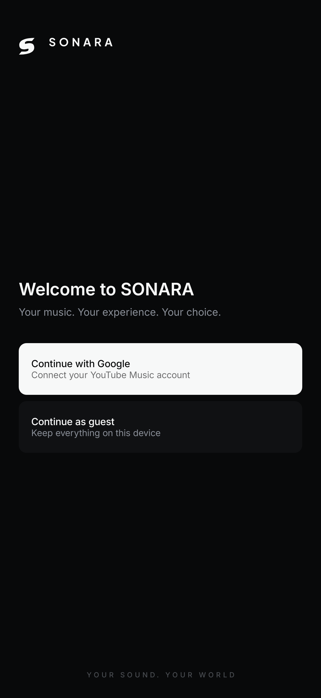
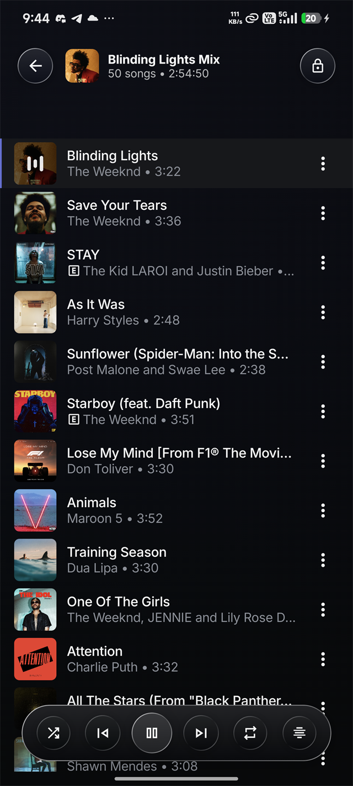

<div align="center">



<br/>

<p align="center">
  <a href="README.md"></a>
  <a href="README.en.md"></a>
</p>

<p align="center">
  <a href="https://github.com/Arkrega/Sonara/releases/latest"></a>
  <a href="https://github.com/Arkrega/Sonara/releases"></a>
  
  
  
  <a href="LICENSE"></a>
</p>

<p align="center">
  <a href="https://github.com/Arkrega/Sonara/releases/latest"><strong>⬇️ Unduh APK Terbaru</strong></a>
  &nbsp;·&nbsp;
  <a href="https://sonara.my.id/"><strong>🌐 Situs Web</strong></a>
  &nbsp;·&nbsp;
  <a href="changelog.md"><strong>📋 Catatan Perubahan</strong></a>
  &nbsp;·&nbsp;
  <a href="README.en.md"><strong>🇬🇧 Read in English</strong></a>
</p>

</div>

> [!WARNING]
> Jika YouTube Music tidak tersedia di wilayah Anda, Sonara memerlukan VPN atau proxy yang terhubung ke wilayah yang didukung agar layanan daring dapat berjalan

<details>
<summary><strong>🇬🇧 Quick English Summary (Click to expand · Full English README available in <a href="README.en.md">README.en.md</a>)</strong></summary>

<br/>

**SONARA** is a modern, open-source YouTube Music client for Android built with a **Hybrid Kotlin + Rust (`sonara-core`)** architecture and **Liquid Glass** optical UI. It delivers zero-copy native Rust DSP (Parametric EQ, Volume Normalization, Stereo Reverb, 24-band real-time FFT spectrum & Shazam audio fingerprinting), synced word-by-word lyrics with AI translation, fullscreen/PiP music videos, Listen Together rooms, and an ultra-lean **~6.16 MB** FOSS release APK.

➡️ Read the full English documentation in **[README.en.md](README.en.md)**

</details>

<div align="center">

</div>

<h2 align="center">📱 Tangkapan Layar</h2>

<p align="center"><sub>Diambil langsung dari perangkat nyata menjalankan Sonara dengan antarmuka Liquid Glass aktif</sub></p>

<div align="center">
<table>
  <tr>
    <td align="center" width="20%">
      <br/>
      <sub><strong>Beranda</strong></sub>
    </td>
    <td align="center" width="20%">
      <br/>
      <sub><strong>Pencarian</strong></sub>
    </td>
    <td align="center" width="20%">
      <br/>
      <sub><strong>Pemutar &amp; Visualizer</strong></sub>
    </td>
    <td align="center" width="20%">
      <br/>
      <sub><strong>Lirik Sinkron</strong></sub>
    </td>
    <td align="center" width="20%">
      <br/>
      <sub><strong>Antrean Putar</strong></sub>
    </td>
  </tr>
</table>
</div>

<div align="center">

</div>

<h2 align="center">⚡ Arsitektur Hybrid Kotlin + Rust</h2>

<div align="center">

</div>

<br/>

<div align="center">

| Komponen | Teknologi | Keunggulan |
|---|---|---|
| **Antarmuka** | Jetpack Compose + AGSL Liquid Glass | Refraksi kaca optik real-time dengan preset **Crystal**, **Balanced**, & **Frosted** |
| **Mesin DSP Native** | Rust (`sonara-core`) Direct `ByteBuffer` | Parametric EQ, Normalisasi Gain, Stereo Reverb, & FFT 24-band tanpa alokasi heap tambahan |
| **Jaringan & Cache** | `SharedHttpPool` + Media3 ExoPlayer | Mulai audio cepat (`500ms`), koneksi terpadu, & smart pre-cache lagu berikutnya |
| **Ukuran Ramping** | R8 Full Obfuscation + Resource Shrinking | APK FOSS rilis hanya **~6.16 MB** (`~150 KB/ABI` untuk library native Rust) |

</div>

<div align="center">

</div>

<h2 align="center">✨ Fitur Unggulan</h2>

<table>
  <tr>
    <td width="50%" valign="top">

### 🎵 Pemutaran & Video
- Streaming lagu dan video musik langsung dari YouTube Music
- Pemutaran latar belakang, unduh & cache untuk dengar offline
- Mode **Video Layar Penuh** lanskap dengan HUD Liquid Glass & **Picture-in-Picture (PiP)**
- Smart pre-cache otomatis untuk lagu berikutnya (dengan opsi khusus Wi-Fi)
- Lewati bagian hening (*Skip Silence*) & *Sleep Timer* dengan fade-out halus

</td>
    <td width="50%" valign="top">

### 🎛️ Audio & Native Rust DSP
- **Liquid Glass Audio Visualizer** 24-band real-time tanpa izin mikrofon
- **Parametric Equalizer**, impor profil AutoEQ, & **Stereo Reverb** diproses native di Rust
- Normalisasi volume lintas format (`PCM16/24/32/Float`) & *Crossfade* mulus
- Kontrol kecepatan, *pitch*, serta mode **Varispeed** secara real-time
- Dukungan pemrosesan audio hemat CPU dengan fallback Kotlin otomatis

</td>
  </tr>
  <tr>
    <td width="50%" valign="top">

### 🎤 Lirik & Penemuan Musik
- Lirik sinkron dengan sorotan **kata per kata** (*word-by-word*)
- Terjemahan lirik berbasis AI (*DeepL* & *OpenRouter*)
- **Share Lyrics Card** bergaya **Liquid Glass** dengan ekspor PNG tajam `2160×2160`
- Pengenalan lagu ala Shazam ditenagai mesin FFT native Rust (`sonara-core`)
- Rekomendasi cepat personal & pencarian lagu, album, artis, video, dan playlist

</td>
    <td width="50%" valign="top">

### 📚 Pustaka & Akun
- Manajemen pustaka lengkap dengan sinkronisasi akun YouTube Music
- Playlist lokal, impor playlist, & ubah urutan lagu di playlist maupun antrean
- Pemotong sampul persegi bawaan Compose (*EXIF-aware*, tanpa library eksternal berat)
- Riwayat pemutaran, statistik mendengarkan, & cadangkan/pulihkan data lokal

</td>
  </tr>
  <tr>
    <td width="50%" valign="top">

### 🔗 Sosial & Integrasi
- **Listen Together** — dengarkan musik bersama teman secara sinkron real-time
- **Discord Rich Presence** lengkap dengan detail lagu yang sedang diputar
- **Last.fm Scrobbling** otomatis

</td>
    <td width="50%" valign="top">

### 🎨 Antarmuka Liquid Glass
- Pilihan kejernihan **Crystal**, **Balanced**, dan **Frosted**
- Tema Terang, Gelap, Hitam Pekat (*Pure Black*), serta Warna Dinamis + **19 palet preset**
- Widget layar utama interaktif (Pemutar, Playlist, Turntable, & Pengenal Lagu)
- Desain Material 3 Expressive yang halus di layar refresh rate tinggi

</td>
  </tr>
</table>

<div align="center">

</div>

<h2 align="center">⬇️ Unduh Sonara</h2>

<div align="center">

<a href="https://github.com/Arkrega/Sonara/releases/latest">
  
</a>
&nbsp;
<a href="https://sonara.my.id/">
  
</a>

<br/><br/>

<sub>Minimal <strong>Android 8.0 (API 26)</strong> · Mendukung <code>arm64-v8a</code> &amp; <code>armeabi-v7a</code> · Pembaruan otomatis langsung di dalam aplikasi</sub>

</div>

<div align="center">

</div>

<h2 align="center">🛠️ Bangun dari Kode Sumber</h2>

Pastikan **JDK 21**, **Android SDK + NDK**, dan **Rust toolchain** (`aarch64-linux-android`, `armv7-linux-androideabi`) sudah terpasang

```bash
git clone https://github.com/Arkrega/Sonara.git
cd Sonara
cargo test --manifest-path sonara-core/Cargo.toml
./gradlew :app:assembleFossDebug
```

Hasil build APK tersedia di `app/build/outputs/apk/foss/debug/app-foss-debug.apk` (atau `app/build/outputs/apk/foss/release/app-foss-release-unsigned.apk` untuk `:app:assembleFossRelease`)

<div align="center">

</div>

<h2 align="center">🙏 Penghargaan</h2>

<p align="center">
  Sonara merupakan fork dari <a href="https://github.com/MetrolistGroup/Metrolist"><strong>Metrolist</strong></a>, yang sebelumnya dibangun di atas <a href="https://github.com/z-huang/InnerTune"><strong>InnerTune</strong></a> dan <a href="https://github.com/DD3Boh/OuterTune"><strong>OuterTune</strong></a>
</p>

<div align="center">

| Proyek | Pengembang |
|---|---|
| **Metrolist** | [Mo Agamy](https://github.com/mostafaalagamy) |
| **InnerTune** | [Zion Huang](https://github.com/z-huang) · [Malopieds](https://github.com/Malopieds) |
| **OuterTune** | [Davide Garberi](https://github.com/DD3Boh) · [Michael Zh](https://github.com/mikooomich) |

</div>

<div align="center">

</div>

<h2 align="center">⚖️ Penafian & Lisensi</h2>

<div align="center">

Proyek ini **tidak berafiliasi, didanai, disahkan, didukung, atau terkait dalam bentuk apa pun** dengan YouTube, Google LLC, maupun anak perusahaan atau afiliasinya

Seluruh merek dagang, merek layanan, dan hak kekayaan intelektual adalah milik pemiliknya masing-masing

<sub>Dilisensikan di bawah <a href="LICENSE"><strong>GNU General Public License v3.0 (GPL-3.0)</strong></a></sub>

<br/><br/>


</div>
