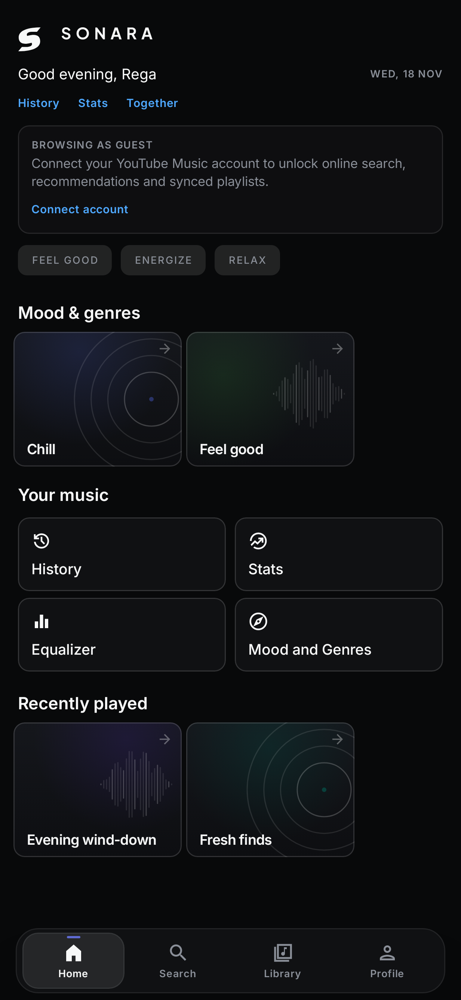
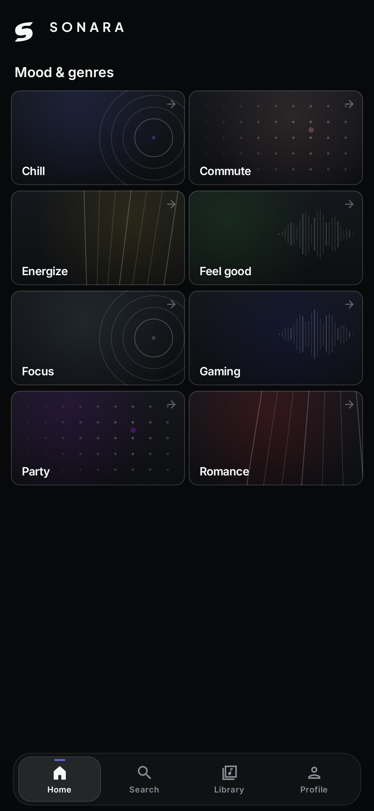
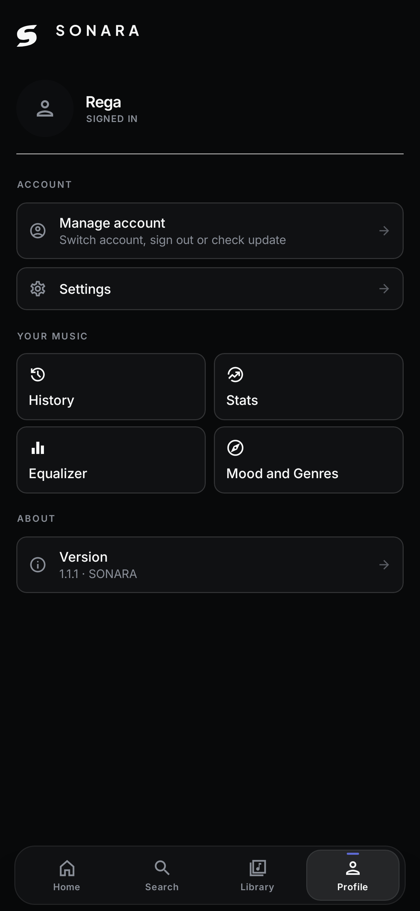

<div align="center">


###### A YouTube Music client for Android

<br/>

[](https://github.com/Arkrega/Sonara/releases)
[](https://github.com/Arkrega/Sonara/blob/main/LICENSE)
[](https://github.com/Arkrega/Sonara/releases)

</div>

<br/>

> [!WARNING]
> If YouTube Music is unavailable in your region, Sonara will not work without a VPN or proxy connecting to a supported region

---

<h2 align="center">Screenshots</h2>

<div align="center">






</div>

---

<h2 align="center">Features</h2>

<table>
  <tr>
    <td width="50%" valign="top">

#### 🎵 Playback
- Stream songs and videos from YouTube Music
- Background playback
- Download & cache for offline listening
- Skip silence
- Sleep timer

</td>
    <td width="50%" valign="top">

#### 🎛️ Audio
- Audio normalization
- Tempo & pitch control
- Equalizer
- Crossfade

</td>
  </tr>
  <tr>
    <td width="50%" valign="top">

#### 🎤 Lyrics & Discovery
- Synced lyrics with word-by-word highlighting
- AI-powered lyrics translation
- Personalized quick picks
- Search songs, albums, artists, videos, and playlists

</td>
    <td width="50%" valign="top">

#### 📚 Library & Account
- Full library management
- Local playlists
- Import playlists
- Reorder songs in playlist or queue
- YouTube Music account login
- Sync songs, artists, albums, and playlists

</td>
  </tr>
  <tr>
    <td width="50%" valign="top">

#### 🔗 Social
- Listen together with friends in real-time
- Last.fm scrobbling
- Discord Rich Presence

</td>
    <td width="50%" valign="top">

#### 🎨 Interface
- Home screen widget
- Light / Dark / Black / Dynamic themes
- Dynamic color + 19 preset palettes
- Material 3 design

</td>
  </tr>
</table>

---

<h2 align="center">Download</h2>

<div align="center">

<a href="https://github.com/Arkrega/Sonara/releases/latest">
  
</a>

</div>

---

<h2 align="center">Building from Source</h2>

```bash
git clone https://github.com/Arkrega/Sonara.git
cd Sonara
./gradlew :app:assembleFossDebug
```

The APK will be at `app/build/outputs/apk/universalFoss/debug/app-universal-foss-debug.apk`

---

<h2 align="center">Acknowledgments</h2>

Sonara is a fork of [Metrolist](https://github.com/MetrolistGroup/Metrolist), which itself was built upon [InnerTune](https://github.com/z-huang/InnerTune) and [OuterTune](https://github.com/DD3Boh/OuterTune)

<div align="center">

| Project | Authors |
|---------|---------|
| **Metrolist** | [Mo Agamy](https://github.com/mostafaalagamy) |
| **InnerTune** | [Zion Huang](https://github.com/z-huang) · [Malopieds](https://github.com/Malopieds) |
| **OuterTune** | [Davide Garberi](https://github.com/DD3Boh) · [Michael Zh](https://github.com/mikooomich) |

</div>

---

<h2 align="center">Disclaimer</h2>

<div align="center">

This project is **not affiliated with, funded, authorized, endorsed by, or in any way associated** with YouTube, Google LLC, or any of their affiliates and subsidiaries

All trademarks, service marks, and intellectual property rights belong to their respective owners

</div>

---

<div align="center">

<sub>Licensed under [GPL-3.0](LICENSE)</sub>

</div>
